<a href="README.md">English</a> · <a href="README.pt-BR.md">Português</a> · <b>Español</b>

**A la 360 le queda cuerda. Trae código que funcione.** Hacemos apps nuevas y abiertas para Xbox 360. Código a la vista, pruebas en consola y crédito para quienes abrieron el camino.

## Código de la casa

**Cosas nuevas para una consola vieja.** La 360 tiene 20 años. Hacemos apps para ella como si hubiera salido ayer, y seguimos mandando actualizaciones.

**Esto no es un club de niños ricos.** A nadie aquí le importa tu universidad, tu setup ni tu apellido. Código y la consola corriéndolo, esa es la entrada.

**La IA es una herramienta aquí.** Si crees que la IA no sirve para escribir código, este no es tu lugar. La usamos todos los días.

**El slop tampoco entra.** Si pegas un prompt y publicas lo que salga sin leerlo, este tampoco es tu lugar. La IA escribe, tú lees cada línea, lo pruebas en una consola real y respondes por lo que subes.

**Da el crédito.** Toolchains, ports y bibliotecas vienen de quienes llegaron antes. Sus nombres se quedan en los créditos.

## Tres niveles

## Apps

## Súmate

&nbsp;&nbsp;&nbsp;&nbsp;

## Reglas

1. **Aquí no entra basura.** Si no corre en una 360 real, no abras la PR.
2. **Usa toda la IA que quieras. El slop se queda fuera.** Trae trabajo que puedas defender. Slop es código que no sabes explicar, una PR enorme sin pruebas, un README genérico lleno de emojis o una plantilla con otro nombre vendida como app nueva.
3. **“Lo hizo la IA” no te salva.** Firmaste, te haces cargo. Si quien revisa pregunta, respondes tú.
4. **Trae algo nuevo.** Antes de proponer una app, muestra qué hace que ninguna otra haga, o por qué la tuya lo hace mejor. Un clon de otro clon se queda fuera.
5. **Piratería, aquí no.** Usa código abierto o hazlo tú. Nada de software pirata, juegos, claves ni SDK filtrados. Si traes eso, quedas fuera.
6. **Corrió en la consola o no corrió.** Sin log, foto, vídeo u otro registro de una 360 real, no hay release.
7. **Bromas sí, ataques no.** Puedes bromear y discrepar. Atacar a la persona, no. La crítica con argumentos técnicos siempre tiene sitio.
8. **Tu app, tu responsabilidad.** Su responsable atiende las issues y los fallos de seguridad.
9. **El crédito se respeta.** Si usas código ajeno, da crédito y cumple la licencia.
10. **Aquí hay jerarquía.** En la org deciden sus dueños; en el proyecto, quien lo mantiene. Se puede debatir. La última palabra la tiene quien responde por ello.
11. **Sube quien aporta.** Acceso y roles crecen por calidad, confianza y contribuciones reales, por invitación de alguien del nivel superior. No hay fórmula de “X PRs = ascenso”. No es automático y nadie sube porque haya una silla vacía.

<b>Catálogo, seguridad, créditos y contacto en detalle</b>

### Catálogo y tres niveles

- **Revive360 Project** — repo dentro de [revive360](https://github.com/revive360), reglas/seguridad de la org, PR revisada y releases del CI firmadas/atestadas; validez continua mientras cumpla las reglas. Sello compacto verde neón con mascota y medalla exclusiva Project, el más fuerte.
- **Reviewed · vX.Y.Z** — repo del autor, solo versión/hash/fecha revisados. Binario nuevo o sustituido vuelve a la cola manual de menor prioridad por llegada (objetivo 14 días); **versión actual no revisada** hasta la aceptación. Autor compila, org comprueba hash y vínculo al código; sin canal de actualización de la org. Si el autor desaparece, el sello caduca.
- **Community list** — descubrimiento sin sello: **No verificado por Revive360; no es una recomendación; úsalo bajo tu responsabilidad.** Puede retirarse en cualquier momento.

El [catálogo](https://github.com/revive360/catalog) es la fuente de verdad; los sellos enlazan a las fichas y muestran válido, versión actual no revisada, caducado o revocado. Ser miembro no es certificación. La org asume responsabilidad operativa por sus repos y las versiones externas revisadas dentro del alcance documentado; un repo de miembro fuera del catálogo es solo del autor. Usar nombre/sello sin ficha es uso indebido. Revisión no es auditoría completa; software **tal cual**, sin garantía del sello.

**[Tube360](https://github.com/revive360/tube360)**: app nativa de YouTube para el 360, MIT, de [@PedroHenrique0713](https://github.com/PedroHenrique0713). Está en la org desde 2026-11-25. Su ficha en el catálogo y el sello Official llegan con su primera release hecha por el CI de la org; hoy el registro Project del catálogo es un ejemplo ficticio.

Seguridad en cualquier nivel: respuesta en **48 h**, revocación inmediata si es grave. Releases Project: CI automático tras revisión y prueba del binario exacto en consola real; revisiones externas FIFO, objetivo **14 días**; Community según capacidad. Nadie revisa su app **excepto el fundador Pedro**, incluso al máximo nivel. [Checklist y límites](../REVIEW.md).

### Ven a aportar

Pásate por [Discussions](https://github.com/orgs/revive360/discussions), muestra qué aporta tu app y trae una parte funcionando. Cuando esté lista, abre **App proposal** o **Join Revive360** en `.github`. Di quién la mantiene, qué licencia usa y de dónde sale cada dependencia. No necesitas ser miembro para aportar. Un proyecto ajeno entra solo con permiso de su responsable. Lee [CONTRIBUTING](../CONTRIBUTING.md), [GOVERNANCE](../GOVERNANCE.md) y el [Código de Conducta](../CODE_OF_CONDUCT.md). Español, portugués e inglés: usa el tuyo.

Esto no salió de la nada. Gracias a [xenosworks](https://github.com/xenosworks), por [xsdk](https://github.com/xenosworks/xsdk), [vulkan4xenon](https://github.com/xenosworks/vulkan4xenon) y [SDL-xenon](https://github.com/xenosworks/SDL-xenon), y a [Free60/libxenon](https://github.com/Free60Project/libxenon). Revive360 complementa este trabajo y conserva sus créditos.

### Personas, riesgo y contacto

Hoy solo el fundador Pedro es dueño de la org. Miembros entran con acceso mínimo y avanzan por contribuciones; no hay promoción automática a dueño. DCO obligatorio. El fundador decide cambios con 14 días de aviso público; restricciones urgentes de seguridad son inmediatas. El autor puede recuperar su proyecto; archivar tras 12 meses sin mantenimiento o por infracciones. La org no recibe ni reparte donaciones por ahora.

**El homebrew puede causar bloqueos en Xbox Live, pérdida de datos y daños a la consola; úsalo bajo tu responsabilidad.** Ninguna recopilación sin opt-in; login/tokens permanecen en la consola. Términos de terceros a cargo del autor; prohibido romper DRM/paywall.

El canal oficial es [Revive360 Discussions](https://github.com/orgs/revive360/discussions), con `.github` como fuente; sin Discord al inicio. Categorías: Anuncios, Ideas de apps, Ayuda y Muestra tu proyecto. Issues/PRs para errores y registros formales de revisión/admisión. Hasta diciembre, seguridad por private vulnerability reporting y contacto público por Discussions.

Xbox y Xbox 360 son marcas de Microsoft. Revive360 es independiente y no está afiliada ni avalada por Microsoft, Google o los proyectos mencionados.

**El homebrew puede causar bloqueos en Xbox Live, pérdida de datos y daños a la consola; úsalo bajo tu responsabilidad.**

Xbox y Xbox 360 son marcas de Microsoft. Revive360 es independiente y no está afiliada ni avalada por Microsoft, Google o los proyectos mencionados.
