<b>English</b> · <a href="README.pt-BR.md">Português</a> · <a href="README.es.md">Español</a>

**The 360 still has work to do. Bring good code.** We build new, open apps for Xbox 360. Show the source, test it on hardware and credit the folks who made this possible.

## House code

**New stuff for an old console.** The 360 is 20 years old. We build for it like it came out yesterday, and we keep shipping updates.

**This isn't a club for rich kids.** Nobody here cares about your school, your setup or your last name. Code and a console running it, that's the way in.

**AI is a tool here.** If you think AI can't write code, this isn't your place. We use it every day.

**Slop doesn't get in either.** If you paste a prompt and ship whatever comes out without reading it, this isn't your place either. AI writes, you read every line, you test it on a real console and you answer for what you ship.

**Credit the folks.** Toolchains, ports and libraries come from people who came before us. Their names stay in the credits.

## Three levels

## Apps

## Get in

&nbsp;&nbsp;&nbsp;&nbsp;

## Rules

1. **No junk gets in.** If it doesn't run on a real 360, don't open a PR.
2. **Use all the AI you want. No slop.** Bring work you can stand behind. Slop means code you can't explain, a huge PR with no tests, an emoji-packed generic README, or a template renamed and called a new app.
3. **“The AI did it” isn't a pass.** You signed it, you own it. If the reviewer asks, you answer.
4. **Bring something new.** Before pitching an app, show what it does that nothing else does, or why yours does it better. A clone of a clone doesn't make the cut.
5. **No piracy here.** Use open code or write your own. No pirated software, games, keys or leaked SDKs. Bring that in and you're out.
6. **Real hardware or it didn't happen.** No release without a log, photo, video or another record from a real 360.
7. **Banter is fine. Personal attacks aren't.** Joke around. Disagree. Back your criticism with technical reasons and leave the person out of it.
8. **Your app, your responsibility.** Its owner handles the issues and security holes.
9. **Credit is non-negotiable.** Credit the people whose code you use and respect the license.
10. **Know who makes the call.** Org owners decide for the org; the maintainer decides for the project. Have the discussion. The person responsible gets the final call.
11. **Step up by showing up.** Access and roles grow through quality, trust and real contribution, by invitation from someone above that role. There's no “X PRs gets you a promotion” deal. Nothing automatic, and an empty seat earns nobody a title.

<b>Catalog, security, credits and contact in detail</b>

### Catalog and three levels

- **Revive360 Project** — repository inside [revive360](https://github.com/revive360), organization rules/security, reviewed PRs and signed/attested CI releases; continuous status while compliant. Dark/neon-green compact mascot badge and exclusive Project medal, strongest level.
- **Reviewed · vX.Y.Z** — external author's repository, only that reviewed version/hash/date. New or replaced binaries return to a lower-priority manual FIFO queue (target 14 days); **current version not reviewed** until accepted. Author builds, org verifies the hash and source linkage; no org update channel. If the author disappears, the badge expires.
- **Community list** — discovery without a badge: **Not verified by Revive360; not a recommendation; use at your own risk.** Entries may be removed at any time.

The [catalog](https://github.com/revive360/catalog) is authoritative; badge images link to app records and can be valid, current-version-not-reviewed, expired or revoked. Membership is not a badge. The org takes operational responsibility for its repos and the external versions reviewed within the documented scope; an unlisted member repo is solely the author's. Unauthorized name/badge use is misuse. Review is not a complete audit; software is **as is**, with no badge warranty.

**[Tube360](https://github.com/revive360/tube360)**: native YouTube app for the 360, MIT, by [@PedroHenrique0713](https://github.com/PedroHenrique0713). It lives in the org since 2026-11-25. Its catalog record and Official badge come with its first release built by the org CI; today the catalog's Project record is a fictional sample.

Security at every level receives a response in **48 hours**, with immediate revocation if severe. Project releases follow the automatic CI flow after review and exact-binary console testing; external reviews target **14 days** FIFO; Community admission is best effort. Nobody reviews their own app **except founder Pedro**, including at the highest level. Read the [checklist and limits](../REVIEW.md).

### Bring something worth building

Start in [Discussions](https://github.com/orgs/revive360/discussions). Show what your app adds and bring a working slice. When it is ready, open **App proposal** or **Join Revive360** in `.github`. Name the owner, license and dependency sources. You can contribute before joining the org. Existing projects join only with their owner’s agreement. Read [CONTRIBUTING](../CONTRIBUTING.md), [GOVERNANCE](../GOVERNANCE.md) and the [Code of Conduct](../CODE_OF_CONDUCT.md). English, português and español all work here.

### Credit where it’s due

This crew did not start from zero. Thanks to [xenosworks](https://github.com/xenosworks): [xsdk](https://github.com/xenosworks/xsdk), [vulkan4xenon](https://github.com/xenosworks/vulkan4xenon) and [SDL-xenon](https://github.com/xenosworks/SDL-xenon), and to [Free60/libxenon](https://github.com/Free60Project/libxenon). Their work makes this possible. Revive360 complements these projects; it does not replace or claim their work.

### People, risk and contact

Only founder Pedro is an owner today. Members start with minimum access and grow through contribution history; no automatic owner promotion. DCO sign-off is mandatory. Rule changes are decided by the founder with 14 days' public notice; urgent security restrictions are immediate. Projects may return to their authors; archive after 12 months without maintenance or for violations. The org currently receives/splits no donations.

**Homebrew risks Xbox Live account/console bans, data loss and console damage; use at your own risk.** No collection without opt-in; login/tokens stay on the console. Third-party terms risk belongs to the author; DRM/paywall bypass is forbidden.

The official community channel is [Revive360 Discussions](https://github.com/orgs/revive360/discussions), sourced from `.github`; no Discord at launch. Categories: Announcements, App ideas, Help, Show and tell. Use issues/PRs for actionable bugs and formal review/admission records. Until December use private vulnerability reporting for security and Discussions for public contact.

Xbox and Xbox 360 are trademarks of Microsoft. Revive360 is independent and is not affiliated with or endorsed by Microsoft, Google or the projects credited above.

**Homebrew risks Xbox Live account/console bans, data loss and console damage; use at your own risk.**

Xbox and Xbox 360 are trademarks of Microsoft. Revive360 is independent and is not affiliated with or endorsed by Microsoft, Google or the projects credited above.
